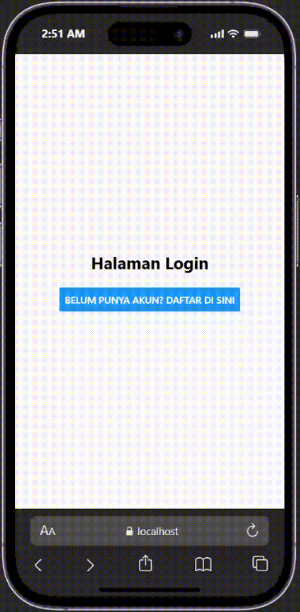
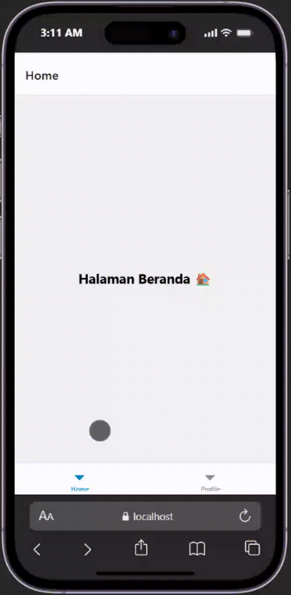
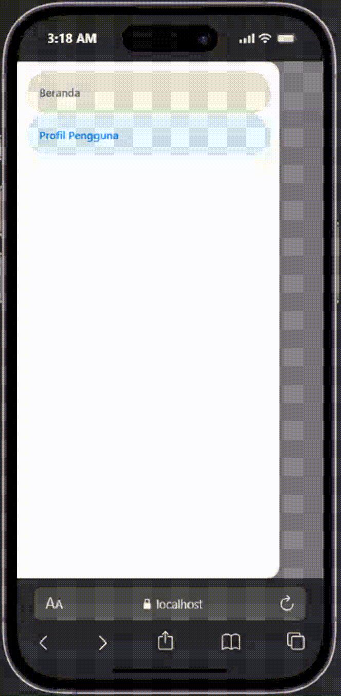

## Praktikum React Native Navigation 

## Tujuan Pembelajaran
Mahasiswa mampu: 
1. Merancang dan menerapkan navigasi antar layar pada aplikasi React Native.
2. Menggunakan library React Native Navigation (Stack, Tab, Drawer Navigation).

## Alur Praktikum

### Langkah 1: Inisialisasi Proyek React Native
1. Buka terminal atau CMD.
2. Ubah direktori ke folder pertemuan 4 (`cd "Pemrograman mobile"`).
3. Buat projek baru menggunakan perintah: `npx create-expo-app ptmn4 --template blank`
4. Masuk ke dalam folder proyek menggunakan perintah: `cd ptmn4`
5. Install core navigation library: `npm install @react-navigation/native`
6. Install dependensi pendukung (wajib untuk Expo): `npx expo install react-native-screens react-native-safe-area-context react-native-gesture-handler react-native-reanimated`

### Langkah 2: Membuat Stack Navigator
1. Instal pustaka stack: `npm install @react-navigation/native-stack`
2. Buat folder di dalam projek dengan nama `screens`.
3. Di dalam folder `screens`, buat 2 file dengan nama `Login.js` dan `Signup.js`.
4. Masukan kode sesuai pada modul praktikum 4.
5. Sesuaikan file `App.js` dengan kode yang ada pada modul.
6. Simpan dan Install dependensi untuk web: `npx expo install react-dom react-native-web`
7. Jalankan perintah: `npx expo start --web`
8. Konfirmasi bukti:

### Langkah 3: Membuat Bottom Tab Navigation
1. Instalasi Pustaka Bottom Tabs: `npm install @react-navigation/bottom-tabs`
2. Buat file `HomeScreen.js` dan `ProfileScreen.js` di dalam folder `screens`.
3. Masukan kode sesuai pada modul praktikum 4.
4. Ubah kode `App.js`, sesuaikan dengan modul praktikum.
5. Konfirmasi bukti:

### Langkah 4: Membuat Drawer Navigation
1. Instalasi Pustaka Drawer: `npm install @react-navigation/drawer`
2. Ubah kembali file `App.js` sesuai dengan code pada module.
3. Konfirmasi Bukti:
